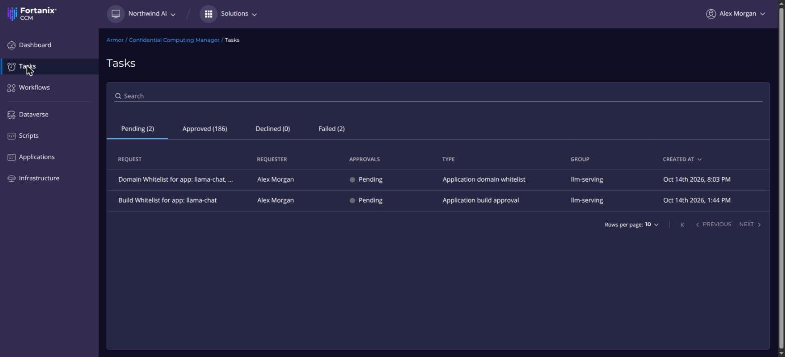
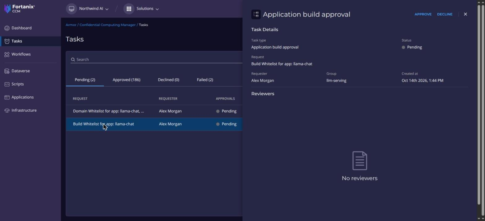

A new build, or a new certificate domain, is a request on the **Tasks** page. Until it is approved, CCM refuses the certificate of any workload that uses it.

## Before you begin

- The Administrator or Editor role in the CCM account.

{/* TODO(verify): how these CCM approval roles relate to the Armor account and group roles (Administrator, Member, Auditor; Group Administrator, Group Auditor). */}

## Approve a request

1. Go to **Tasks**. The **Pending** tab lists the requests waiting for approval, with their type, requester and group.
2. Click a request to see its details.
3. Check that it is the build or domain you expect, then click **APPROVE**, or **DECLINE** to refuse it.

<Screenshots>
<Screenshot caption="Pending requests">

</Screenshot>
<Screenshot caption="Request details">

</Screenshot>
</Screenshots>

Approve only builds whose measurements you produced or checked yourself. An approved build is what CCM certifies.

## Verify

- The request moves to the **Approved** tab.
