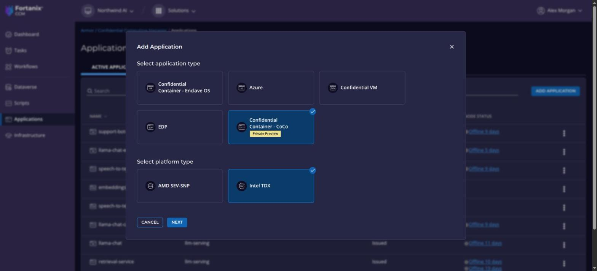
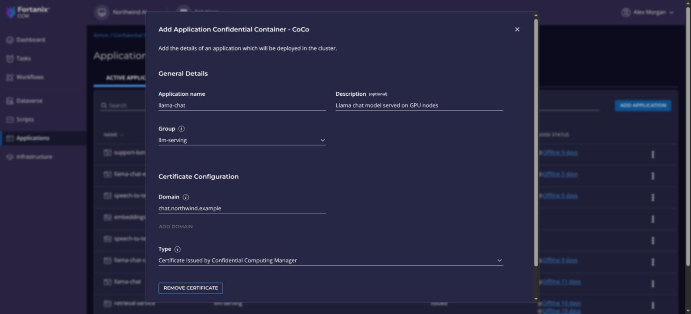

CCM issues a workload's certificate only when the workload attests with the measurements of an approved build of its application. You register the application once, with the domain of its certificate, and add a build for every version you deploy.

## Before you begin

- A CCM account and a group for the application.
- The measurements of the build, from [Confidential Containers](../../workload-runtimes/confidential-containers/take-measurements.mdx) or the [Enclave OS converter](../../workload-runtimes/enclave-os/convert-an-image.mdx).
- Choose the runtime. Every tab set on this page follows your choice.

## Add the application

<Tabs groupId="runtime">
<Tab label="Confidential Containers">

1. Go to **Applications** and click **ADD APPLICATION**.
2. Select **Confidential Container - CoCo** and **Intel TDX**, and click **NEXT**.
3. Enter the **Application name**, a **Description** if you like, and the **Group**.
4. Under **Certificate Configuration**, enter the **Domain** of the workload's certificate. Click **ADD DOMAIN** for more. Leave **Type** as **Certificate Issued by Confidential Computing Manager**.
5. Click **Add Application**.

<Screenshots>
<Screenshot caption="Choose the type and platform">

</Screenshot>
<Screenshot caption="Enter the details">

</Screenshot>
</Screenshots>

</Tab>
<Tab label="Enclave OS">

1. Go to **Applications** and click **ADD APPLICATION**.
2. Select **Confidential Container - Enclave OS** and **Intel TDX**, and click **NEXT**.
3. Create the application image from the converter's measurements. If you converted with GPU passthrough, set **NVIDIA GPU Attestation** to **Required**.
4. Go to **CONFIGURATION** and click **+ ADD CONFIGURATION**. Select **Add new configuration**, choose the image, enter a name, and select your group. Leave **Ports** and **Configuration items** empty. Click **SAVE**.

{/* TODO(verify): steps 3 and 4 come from the source, which starts from the group's APPLICATIONS page; check them against the current Add Application dialog. */}

</Tab>
</Tabs>

A new application needs approval. See [Approve builds and domains](approve-builds-and-domains.mdx).

## Add a build

<Tabs groupId="runtime">
<Tab label="Confidential Containers">

1. Open the application and click **ADD BUILD**.
2. Enter a unique **Build Version**, then MRTD, RTMR0 to RTMR3, and MR_CONFIG_ID (the hash of the workload's InitData).
3. Set **Coprocessors** to **Required** for a workload with a GPU, so that CCM also checks the GPU's evidence through NVIDIA NRAS. Set it to **Ignored** for one without.
4. Click **Add Build**.

</Tab>
<Tab label="Enclave OS">

Each converted image is a build, and the measurements you enter with the application image identify it.

{/* TODO(verify): how to add a further build to an existing Enclave OS application. */}

</Tab>
</Tabs>

The build is listed on the application's **Builds** tab, and needs approval before CCM certifies a workload with its measurements.

## Verify

- The application is listed under **Applications**.
- After the build is approved and a workload runs, the build shows as **Deployed** on **Builds**, and the **Certificates** tab lists the workload's certificate.
