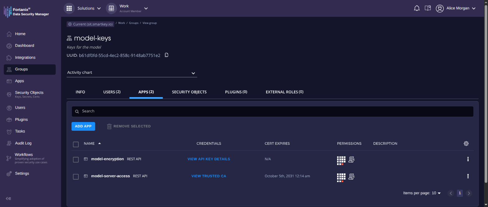

import CreateDsmGroup from '../../../../_flows/dsm/create-group.mdx';
import CreateApiKeyApp from '../../../../_flows/dsm/create-api-key-app.mdx';
import CreateTrustedCaApp from '../../../../_flows/dsm/create-trusted-ca-app.mdx';

The model owner does this. The key that protects the model stays in DSM, and DSM releases it only to a workload with a certificate from the consumer's CCM account.

You need two DSM apps in one group. One encrypts the model, and the workload authenticates as the other.

## Before you begin

- A Fortanix DSM account.
- From [Set up CCM](set-up-ccm.mdx), the application ID of the model owner's application, and the model consumer's zone CA certificate.

## Create a group

Create a group for the model's keys, such as `model-keys`, or use one you already have. Both apps go in it.

<CreateDsmGroup />

## Create the encryption app

The people who encrypt models use this app's API key. Keep the key with them, and out of every image.

<CreateApiKeyApp />

## Create the Trusted CA app

The workload authenticates as this app, with its CCM certificate. Two settings matter.

- **DNS Name** is `<APPLICATION_ID>.app.fortanix.cloud`, where `<APPLICATION_ID>` is the application ID of the model owner's application in CCM, the one its measurements are registered in.
- **UPLOAD TRUSTED CA CERT** takes the consumer's zone CA certificate.

<CreateTrustedCaApp />

Don't use a generic DNS name, such as the application's own domain. Only CCM puts a name ending in `.fortanix.cloud` in a certificate, and only after verifying the workload's attestation. Nobody can add an application whose domain ends in `.fortanix.cloud`. And the consumer can't get another certificate with this name from its own zone CA, unless the model owner approves a new workflow for it. So DSM releases the key only to the approved application, never to some other application in the consumer's account.

## Verify

- The group's **APPS** tab lists both apps, one with **VIEW API KEY DETAILS** and one with **VIEW TRUSTED CA**.

## Next steps

- [Protect the model](protect-the-model.mdx)
